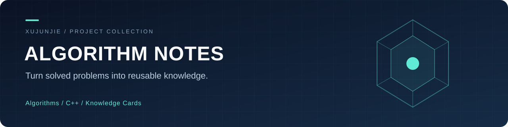

# 算法竞赛进阶指南 · 学习与复盘
> 把题目练习整理为可以继续复习的知识卡片、题目复盘和代码模板。

**C++ · 算法与数据结构 · 知识归档 · 学习进度**

[学习进度](progress.md) · [知识卡片](knowledge/) · [题目复盘](problems/) · [代码模板](templates/)

## 仓库定位

本仓库围绕《算法竞赛进阶指南》建立学习记录：题目复盘保留具体问题，知识卡片归纳可复用思路，模板目录保存后续可以调用的实现。内容持续积累，当前收录范围以文件为准。

## 已收录内容

| 主题 | 知识与复盘 | 模板 |
| --- | --- | --- |
| 字符串哈希 | [知识卡片](knowledge/字符串/字符串哈希.md)、[NC50987 Palindrome](problems/nowcoder-nc50987-palindrome.md) | [rolling-hash-string.cpp](templates/rolling-hash-string.cpp) |
| 二分答案 | [知识卡片](knowledge/0x04-基本算法-二分/二分答案.md) | [binary-search-answer.cpp](templates/binary-search-answer.cpp) |
| 递归与枚举 | [递归指数型枚举](knowledge/递归/递归指数型枚举.md)、[子集枚举复盘](problems/recursive-subset-enumeration.md) | 见对应复盘 |

## 内容结构

```text
knowledge/    原理、状态含义与易错点
problems/     题目分析、实现思路与复盘
templates/    可复用代码模板
progress.md   学习进度
state.json    当前学习流程状态
```

## 阅读方式

从一道题的复盘进入，先理解状态、转移或不变量，再阅读对应知识卡片与模板。模板适用范围和边界条件应结合题目重新判断；历史验证不能替代新题的测试。

本库侧重结构化复盘；更多历史刷题源文件见 [algorithm-learning-journey](https://github.com/xujunjie-coder/algorithm-learning-journey)。

## 展示重点

适合展示如何从“完成一道题”推进到“解释正确性、提炼方法、记录易错点”。仓库目录区分题目记录与可复用知识，方便在后续题目中检索。

## 授权

仓库根目录尚无项目许可证；题目原文、题解引用与原创实现的授权需分别确认。
